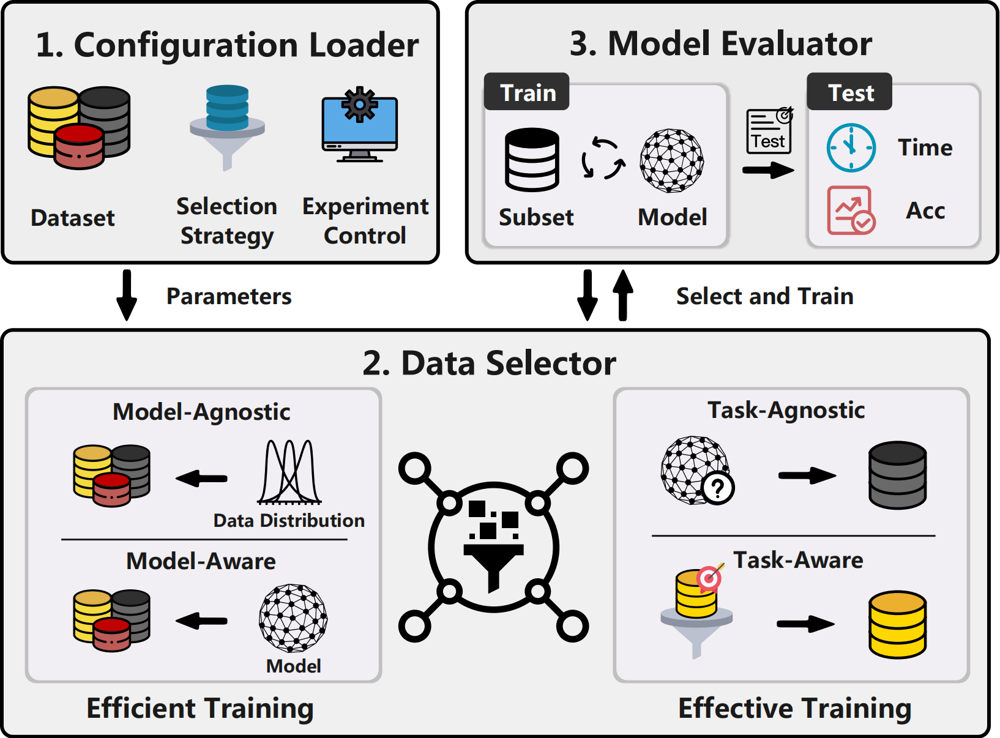

# Data Selection Testbed

[](https://www.python.org/downloads/release/python-370/)
[](https://pytorch.org/)
[](LICENSE)

<div align="center">
  
</div>

The success of supervised deep learning depends on the quantity and quality of labeled training data. However, as training datasets grow larger, they inevitably contain noisy or even harmful instances, increasing computational costs and hindering model performance. Existing data selection strategies typically focus on improving training effectiveness by selecting high-quality data or increasing efficiency by reducing training time without sacrificing accuracy. 

Although numerous data selection methods have been proposed, ranging from efficiency-focused to effectiveness-focused strategies and from model-agnostic to model-aware approaches, their performance varies significantly across datasets and tasks, with no universally superior method identified to date. This work presents the first comprehensive survey and empirical evaluation of representative data selection methods, spanning traditional deep learning and supervised fine-tuning (SFT) for large language models (LLMs). We introduce a unified open-source testbed that implements 15 methods and systematically evaluates them under various datasets, model architectures, etc. Furthermore, we extend the evaluation to SFT for LLMs, benchmarking 10 popular methods on 4 downstream tasks. Our results provide actionable insights into the strengths, limitations, and practical trade-offs of different strategies, offering valuable guidance to researchers and practitioners in selecting the appropriate data selection methods for their specific scenarios

## 📋 Table of Contents

- [Overview](#overview)
- [Architecture](#architecture)
- [Installation](#installation)
- [Quick Start](#quick-start)
- [Deep Learning Data Selection](#deep-learning-data-selection)
- [LLMs SFT Data Selection](#llms-sft-data-selection)
- [Datasets](#datasets)
- [Evaluation Metrics](#evaluation-metrics)
- [Citation](#citation)
- [License](#license)

## 🎯 Overview

This testbed provides a comprehensive framework for evaluating data selection strategies across diverse datasets and model architectures. It consists of three main modules:

🔧 **Configuration Loader**: Allows users to configure datasets, models, parameters, data selection strategies, and experimental controls (e.g., logging).

🎯 **Data Selector**: Offers 15 data selection strategies for efficient and effective training. It runs a data selection strategy specified in the user configuration to select a subset of data and passes it to the Model Evaluator. For iterative strategies, the Data Selector and Model Evaluator interact to continuously improve the model performance.

📊 **Model Evaluator**: Trains the target model using the selected data subset and evaluates its performance on the test set, measuring both accuracy and latency.


<div align="center">
  
</div>

## 🏗️ Architecture

🏛️ The testbed is designed with a modular architecture that enables seamless switching between different methods and makes it easy to integrate new strategies for benchmarking or research purposes. The modular design facilitates easy integration of new data selection methods, datasets, and model architectures.

🔌 **Modular Design**: Easy integration of new methods and datasets
🔄 **Seamless Switching**: Quick comparison between different strategies  
📈 **Scalable Framework**: Support for various model architectures and datasets

## 🚀 Installation

### 📋 Prerequisites

🐍 **Python 3.7+** - Core programming language
🔥 **PyTorch 1.0+** - Deep learning framework
⚡ **CUDA** (optional) - GPU acceleration support

### ⚙️ Setup

```bash
# 📥 Clone the repository
git clone <repository-url>
cd data_selection_lib

# 📦 Install dependencies
pip install -r requirements.txt
```

## ⚡ Quick Start

🚀 **Get started in minutes with our comprehensive data selection framework!**

```python
import torch
from torch.utils.data import DataLoader
import nets
from mydatasets import adult
from selection.kmeans import KMeansSelection
from model_utils import train_model, evaluate_model

# ⚙️ Basic configuration
data_path = "mydatasets"
method = 'kmeans'
task_type = 'classification'
device = torch.device("cuda" if torch.cuda.is_available() else "cpu")

# 📊 Load dataset
channel, im_size, num_classes, class_names, mean, std, dst_train, dst_val, dst_test = adult(data_path, balance_target=True)

# 🤖 Initialize model
base_model = nets.__dict__['MLP'](
    channel=channel,
    num_classes=num_classes,
    im_size=im_size,
    pretrained=False
)

# 🎯 Data selection
selector = KMeansSelection()
core_loader = selector.select(
    model=base_model,
    selection_fraction=0.1,
    k=num_classes,
    train_set=dst_train,
    task_type=task_type,
    device=device
)

# 🏋️ Train and evaluate
trained_model = train_model(
    model=base_model,
    train_loader=core_loader,
    val_loader=DataLoader(dst_val, batch_size=128, shuffle=False),
    device=device,
    task_type=task_type,
    epochs=100,
    patience=10
)

# 📈 Evaluate model performance
evaluate_model(
    model=trained_model,
    test_loader=DataLoader(dst_test, batch_size=128, shuffle=False),
    device=device,
    task_type=task_type
)
```

## 🧠 Deep Learning Data Selection

🎯 Our testbed implements **15 representative data selection strategies** covering both efficient and effective training approaches:

💡 **Model-Agnostic Methods**: Work with any model architecture
🧠 **Model-Aware Methods**: Leverage model-specific information for better selection

### Implemented Methods

| Method | Category | Description | Implementation |
|--------|----------|-------------|----------------|
| **K-Means** | Model-agnostic | Clustering-based selection using K-means algorithm | ✅ [selection/kmeans.py](selection/kmeans.py) |
| **Herding** | Model-agnostic | Core-set selection using herding algorithm | ✅ [selection/herding.py](selection/herding.py) |
| **K-Center Greedy** | Model-agnostic | Greedy k-center clustering for core-set selection | ✅ [selection/kcentergreedy.py](selection/kcentergreedy.py) |
| **Random** | Model-agnostic | Random sampling baseline | ✅ [selection/random.py](selection/random.py) |
| **Full** | Model-agnostic | Full dataset training baseline | ✅ [selection/full.py](selection/full.py) |
| **CRAIG** | Model-aware | Gradient-based core-set selection | ✅ [selection/craig.py](selection/craig.py) |
| **GradMatch** | Model-aware | Gradient matching for data selection | ✅ [selection/gradmatch.py](selection/gradmatch.py) |
| **GLISTER** | Model-aware | Glister selection | ✅ [selection/glister.py](selection/glister.py) |
| **CREST** | Model-aware | Core-set selection with gradient-based scoring | ✅ [selection/crest.py](selection/crest.py) |
| **TracIn** | Model-aware | Training data influence estimation | ✅ [selection/TracIn.py](selection/TracIn.py) |
| **LiSSA** | Model-aware | Linear time second-order algorithm | ✅ [selection/LiSSA.py](selection/LiSSA.py) |
| **Arnoldi** | Model-aware | Arnoldi iteration for influence computation | ✅ [selection/Arnoldi.py](selection/Arnoldi.py) |
| **TMCS** | Model-aware | Monte Carlo Shapley Value estimation | ✅ [selection/TMCS.py](selection/TMCS.py) |
| **KNN-Shapley** | Model-aware | K-nearest neighbors Shapley value estimation | ✅ [selection/KNN_shapley.py](selection/KNN_shapley.py) |
| **CS-Shapley** | Model-aware | Class-wise Shapley value computation | ✅ [selection/cs_shapley.py](selection/cs_shapley.py) |
| **G-Shapley** | Model-aware | G-Shapley value estimation | ✅ [selection/G_shapley.py](selection/G_shapley.py) |
| **DVRL** | Model-aware | Data valuation using reinforcement learning | ✅ [selection/dvrl.py](selection/dvrl.py) |
| **DBAL** | Model-aware | Deep bayesian active learning | ✅ [selection/dbal.py](selection/dbal.py) |
| **DFAL** | Model-aware | Deep fool active learning | ✅ [selection/dfal.py](selection/dfal.py) |
| **Boundary Aware** | Model-aware | Boundary-aware data selection | ✅ [selection/boundary_aware.py](selection/boundary_aware.py) |
| **CG-Influence** | Model-aware | Conjugate gradient influence estimation | ✅ [selection/cg_influence.py](selection/cg_influence.py) |
| **SVP Max Entropy** | Model-aware |  maximum entropy with proxy model | ✅ [selection/svp_max_entropy.py](selection/svp_max_entropy.py) |


### 🤖 Supported Models

🖼️ The testbed supports various model architectures:

🔧 **CNNs**: ResNet, VGG, AlexNet, InceptionV3, MobileNetV3, WideResNet, ViT
🧠 **MLPs**: Standard MLP, TabNet, TabTransformer  
🔄 **RNNs**: LSTM
⚡ **Transformers**: BERT, T5
🎯 **Specialized**: DSN, EfficientNet


### 📊 Supported Datasets

#### 🎯 In-Distribution (ID) Datasets
🖼️ **CIFAR-100** - Large-scale image classification (100 classes)
🖼️ **TinyImageNet** - Image classification with rich visual diversity (200 classes)
📊 **Adult** - Census income prediction (tabular data)
📝 **IMDB-Large** - Large-scale text classification (>20M records)
📊 **Covtype** - Large-scale multiclass classification (tabular data)
🚴 **Bike** - Regression benchmark (tabular data)
📝 **IMDB** - Binary text classification
📰 **News** - Multiclass text classification

#### 🔄 Out-of-Distribution (OOD) Datasets
🔄 **MNIST→MNIST-M** - Domain adaptation (synthetic backgrounds)
🔄 **MNIST-M→MNIST** - Reverse domain adaptation
👥 **HR** - Employee attrition prediction (cross-departmental)
🏠 **House** - House price prediction (cross-city)

## 🤖 LLMs SFT Data Selection

*This section is reserved for Large Language Models Supervised Fine-Tuning data selection methods.*

### Methods Comparison Table

| Method | Open Source | Repository/Implementation | Notes |
|--------|-------------|---------------------------|-------|
| **Method 1** | ✅ | [Link to implementation] | Official implementation |
| **Method 2** | ❌ | [Our implementation] | Self-implemented based on paper |
| **Method 3** | ✅ | [Link to implementation] | Official implementation |
| **Method 4** | ❌ | [Our implementation] | Self-implemented based on paper |

*Note: This table will be populated with LLM-specific data selection methods for supervised fine-tuning scenarios.*

## 📊 Datasets

### Dataset Statistics

| Dataset | Type | Modality | Classes | Dataset Size | Distribution |
|---------|------|----------|---------|--------------|--------------|
| CIFAR-100 | Classification | Image | 100 | 60,000 | ID |
| TinyImageNet | Classification | Image | 200 | 110,000 | ID |
| Adult | Classification | Tabular | 2 | 48,842 | ID |
| IMDB-Large | Classification | Text | 2 | 22,500,000+ | ID |
| Covtype | Classification | Tabular | 7 | 581,012 | ID |
| Bike | Regression | Tabular | - | 17,358 | ID |
| IMDB | Classification | Text | 2 | 50,000 | ID |
| News | Classification | Text | 4 | 142,170 | ID |
| MNIST→MNIST-M | Classification | Image | 10 | 70,000 | OOD |
| MNIST-M→MNIST | Classification | Image | 10 | 70,000 | OOD |
| HR | Classification | Tabular | 2 | 12,500 | OOD |
| House | Regression | Tabular | - | 18,750 | OOD |

### Data Distribution

- **In-Distribution (ID)**: Training and test sets share the same data distribution
- **Out-of-Distribution (OOD)**: Training and test sets come from different distributions
- **Train/Val/Test Split**: 80%/10%/10% for ID datasets
- **OOD Split**: Following [Data Shapley](https://arxiv.org/abs/1904.02868) methodology

## 📈 Evaluation Metrics

### 🎯 Effectiveness Metrics

📊 **Classification Tasks**: F1-score
  - F1-score = 2 × (Precision × Recall) / (Precision + Recall)
📈 **Regression Tasks**: Mean Squared Error (MSE)
  - MSE = (1/n) × Σ(y - y_predict)²

### ⚡ Efficiency Metrics

⏱️ **Data Selection Time**: Time required for subset selection
🏋️ **Model Training Time**: Total training time with selected subset


## 🔧 Configuration

⚙️ The testbed uses YAML configuration files for easy customization:

📝 **Flexible Configuration**: Easy parameter tuning
🎛️ **Modular Settings**: Separate configs for different components
🔄 **Batch Experimentation**: Run multiple experiments with different parameters

### 📋 Configuration Structure

The testbed uses `experiments.yaml` for experiment configuration and `experiment_runner.py` for batch execution:

```yaml
# experiments.yaml - Data Selection Experiment Configuration
general:
  # Dataset Configuration
  data_path: "mydatasets"
  dataset: "adult"
  balance_target: true
  
  # Model Configuration
  model_name: "MLP"
  task_type: "classification"
  device: "auto"  # auto, cpu, cuda
  
  # Training Parameters
  epochs: 20
  batch_size: 128
  patience: 8
  selection_lr: 0.001
  selection_momentum: 0.9
  selection_weight_decay: 0.0005

# Experiment List - Multiple Methods and Fractions Comparison
experiments:
  - name: "arnoldi_10percent"
    method: "arnoldi"
    selection_fraction: 0.1
    recursion_depth: 20
    damping: 0.01
    scale: 25.0
    num_test_samples: 1
    pretrain_epochs: 3

  - name: "dvrl_05percent"
    method: "dvrl"
    selection_fraction: 0.05
    num_epochs: 10
    learning_rate: 0.001

# Results Save Configuration
results:
  save_path: "results"
  log_path: "logs"
  models_path: "best_models"
  comparison_file: "comparison_results.csv"
```

## 📚 Usage Examples

### 🚀 Running a Single Experiment

```bash
python main.py --method kmeans --dataset adult --model MLP --selection_fraction 0.1
```

### 🔄 Running Multiple Methods

```bash
# 🎯 Run all methods on a dataset
python run_experiments.py --dataset adult --methods kmeans,herding,craig,glister
```

### 🧪 Batch Experimentation with Configuration

The testbed provides a powerful batch experimentation system using YAML configuration:

```bash
# 🚀 Run all experiments defined in experiments.yaml
python experiment_runner.py

# 📋 Use custom configuration file
python experiment_runner.py custom_experiments.yaml
```

**Key Features:**
- 📊 **Batch Execution**: Run multiple experiments with different parameters
- 📝 **Detailed Logging**: Each experiment gets its own log file
- 📈 **Results Comparison**: Automatic CSV export with performance metrics
- 🔄 **Parameter Sweeping**: Easy testing of different selection fractions and methods

### 🔌 Custom Dataset Integration

```python
from mydatasets import YourDataset
from methods.your_method import YourSelectionMethod

# 📊 Load your dataset
dataset = YourDataset(data_path)

# 🎯 Use your selection method
selector = YourSelectionMethod()
selected_data = selector.select(dataset, fraction=0.1)
```

## 🏃‍♂️ Running Experiments

### 💻 Hardware Requirements

🖥️ **GPU**: 4× NVIDIA RTX 3090 (24GB each)
⚡ **CPU**: Dual Intel Xeon Gold 6148 (80 threads total)
💾 **RAM**: 1 TiB system memory

### 🧪 Experiment Management

The testbed provides comprehensive experiment management through:

📋 **Configuration-Driven**: Define experiments in YAML files
🔄 **Batch Processing**: Run multiple experiments automatically
📊 **Result Tracking**: Automatic logging and result comparison
🎯 **Parameter Sweeping**: Test different selection fractions and methods

### 📊 Result Analysis

After running experiments, results are automatically saved in multiple formats:

- 📈 **CSV Comparison**: Multi-index format for easy analysis
- 📝 **Individual Logs**: Detailed logs for each experiment
- 🤖 **Model Checkpoints**: Best models saved for each experiment
- 📊 **Performance Metrics**: Accuracy, F1-score, timing information

### 🎛️ Hyperparameter Optimization

🔍 We employ [Optuna](https://optuna.org/) for hyperparameter optimization using grid search. See Appendix for detailed hyperparameter configurations.

⚙️ **Automated Tuning**: Optimize parameters automatically
📊 **Grid Search**: Systematic parameter exploration


## 🤝 Contributing

🌟 We welcome contributions! Please feel free to submit a Pull Request. For major changes, please open an issue first to discuss what you would like to change.

💡 **Open Source**: Community-driven development
🔧 **Easy Integration**: Simple process for adding new methods

### 🔧 Adding New Methods

📁 **1. Create a new file** in the `selection/` directory
⚙️ **2. Implement the selection interface**
🔗 **3. Add the method** to `import_methods.py`
📝 **4. Update the documentation**

### 🧪 Adding New Experiments

📋 **1. Update `experiments.yaml`** with new experiment configurations
🔧 **2. Add method mapping** in `experiment_runner.py` if needed
📊 **3. Test with single experiment** before batch running
📈 **4. Verify results** in the generated CSV files

### 📊 Adding New Datasets

📁 **1. Create a new file** in the `mydatasets/` directory
⚙️ **2. Implement the dataset interface**
🔧 **3. Add preprocessing and loading functions**
📋 **4. Update the dataset registry**

## 📄 License

This project is licensed under the MIT License - see the [LICENSE](LICENSE) file for details.

<!-- ## 🙏 Acknowledgments

We thank the authors of the original papers for their valuable contributions to the field of data selection. This testbed builds upon their foundational work.

## 📞 Contact

For questions and issues, please open an issue on GitHub or contact the maintainers. -->

---

**Note**: This is the first open-source testbed for comprehensive data selection evaluation. We hope it will facilitate research and development in the field of efficient and effective data selection for machine learning. 